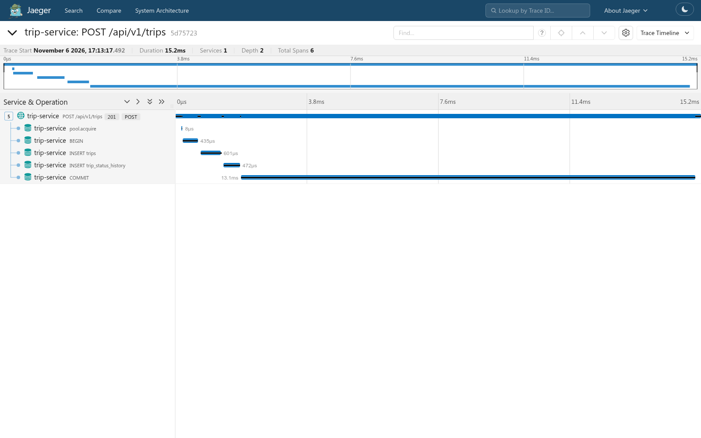
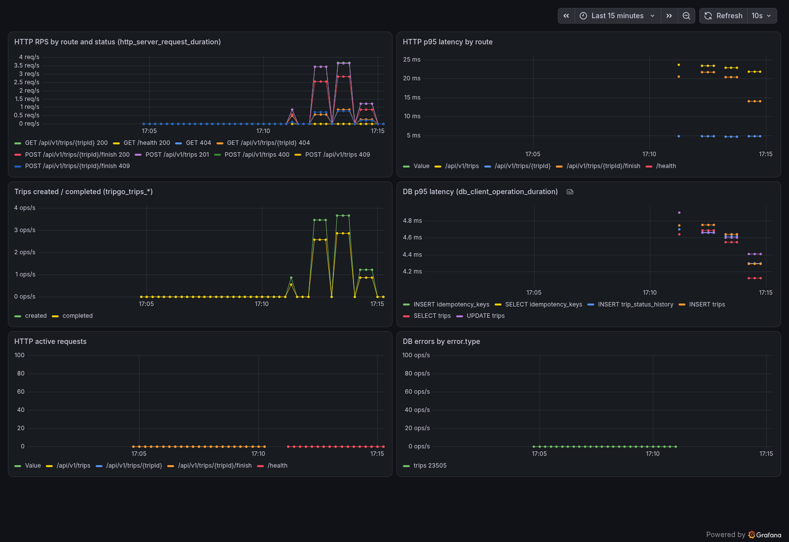

# Лабораторная 2

## Запуск

Для запуска нужно поднять окружение (postgres и телеметрию), применить миграции и запустить сам сервис:

```bash
tripgoctl cluster start
tripgoctl environment start
make migrate
make run
```

Адреса Jaeger, Grafana и Prometheus печатает `tripgoctl connect`.

## Тесты и линтер

- `make lint` запускает `golangci-lint`.
- `make test` запускает unit-тесты с `-race` и печатает покрытие `domain + usecase`.
- `make test-integration` проверяет репозитории на postgres из `DATABASE_URL`, поэтому окружение `tripgoctl` должно быть поднято.
- `make generate` генерирует код по OpenAPI и моки.

Интеграционные тесты отделены билд-тегом `integration`, каждый тест создаёт и удаляет свои данные.

## Переменные окружения

Все переменные обязательные, кроме `OTEL_EXPORTER_OTLP_PROTOCOL`, `OTEL_RESOURCE_ATTRIBUTES` и `OTEL_TRACES_SAMPLER`.

| Переменная | Пример | Назначение |
|---|---|---|
| `HTTP_ADDR` | `:8080` | адрес HTTP-сервера |
| `HTTP_READ_TIMEOUT` | `5s` | суммарный таймаут запроса |
| `HTTP_READ_HEADER_TIMEOUT` | `2s` | таймаут для получения хэдеров запроса |
| `HTTP_WRITE_TIMEOUT` | `10s` | таймаут ответа |
| `HTTP_IDLE_TIMEOUT` | `60s` | таймаут keep-alive соединений |
| `LOG_LEVEL` | `info` | уровень логов |
| `SHUTDOWN_TIMEOUT` | `10s` | таймаут ожидания для graceful shutdown |
| `DATABASE_URL` | `postgres://...` | URL PostgreSQL |
| `DATABASE_MAX_CONNS` | `10` | максимальный размер пула соединений |
| `DATABASE_MIN_CONNS` | `2` | минимальный размер пула |
| `DATABASE_MAX_CONN_LIFETIME` | `30m` | через сколько соединение пересоздаётся |
| `DATABASE_CONNECT_TIMEOUT` | `5s` | таймаут подключения к базе |
| `DATABASE_QUERY_TIMEOUT` | `3s` | таймаут каждого запроса к базе, в том числе `BEGIN` и `COMMIT` |
| `IDEMPOTENCY_KEY_TTL` | `24h` | время жизни ключа идемпотентности |
| `OTEL_SERVICE_NAME` | `trip-service` | имя сервиса в телеметрии и логах |
| `OTEL_EXPORTER_OTLP_ENDPOINT` | `http://localhost:4318` | адрес коллектора |
| `OTEL_EXPORTER_OTLP_PROTOCOL` | `http/protobuf` | протокол OTLP |
| `OTEL_RESOURCE_ATTRIBUTES` | `service.namespace=tripgo,...` | атрибуты ресурса |
| `OTEL_TRACES_SAMPLER` | `parentbased_always_on` | сэмплер |

Таймаутов HTTP-сервера и `IDEMPOTENCY_KEY_TTL` нет в дефолтных значениях курса, поэтому они заданы в секции `[env]` файла `environment.toml`.

## Архитектура

```
http -------> usecase ---> domain <--- repository ---> infra/postgres
  |              |                         |
  +---> model <--+-------------------------+
container ---> все пакеты
```

- `domain/trip`: поездка, переход `Finish`, валидация и доменные ошибки. Не зависит от других слоёв.
- `usecase/trip/{create,get,finish}`: сценарии, знают только домен и свои интерфейсы.
- `http/trip/{create,get,finish}`: хендлеры. `http/domainerror` является единственным местом, где ошибка превращается в HTTP-ответ.
- `repository/{trip,idempotency}`: запросы через squirrel и pgx.
- `infra/postgres`, `infra/telemetry`: пул, менеджер транзакций, OpenTelemetry и логгер.
- `container`: единственное место, где создаются реализации и связываются между собой.

Правила зависимостей проверяет `depguard` в `make lint`.

Интерфейсы объявлены у потребителя, в `contract.go` пакета, который их использует. Так каждый usecase описывает ровно те методы, которые ему нужны, моки получаются маленькими, а реализацию можно подменить, не трогая потребителя. Когда появится gRPC, рядом с `http` добавится свой транспорт, а usecase и домен не изменятся.

От раскладки из задания отличаются `cmd/trip-service` и `api/`, так требует `docs/conventions.md`.

## Принятые решения

### Уровень изоляции

Используется уровень изоляции Read Committed. Параллельные создания разрешает уникальный индекс, а параллельные завершения сериализует `SELECT ... FOR UPDATE`, поэтому более строгий уровень не нужен.

### Одна активная поездка на водителя

Индекс для ограничения одной активной поездки на водителя:

```sql
CREATE UNIQUE INDEX trips_one_active_per_driver_idx
    ON trips (driver_id)
    WHERE status = 'active';
```

При двух параллельных вставках вторая ждёт первую и получает `23505`, которую репозиторий превращает в `ErrDriverBusy`.

### Менеджер транзакций

`Do` открывает транзакцию, кладёт её в контекст и вызывает `fn`. Если `fn` вернула ошибку или запаниковала, транзакция откатывается, иначе коммитится. Вложенный `Do` находит транзакцию в контексте и переиспользует её.

### Телеметрия

Шаблон маршрута вычисляется до старта спана, поэтому в имени спана, метриках и логах всегда `/api/v1/trips/{tripId}`, а не конкретный id. Запросы в БД трейсит `otelpgx` на уровне пула. На каждый запрос пишется одна запись в лог с `trace_id`, ошибка 5xx попадает в неё же.

## Проверка

Трейс `POST /api/v1/trips` в Jaeger: корневой HTTP-спан и вложенные спаны запросов в БД.



Метрики HTTP, БД и `tripgo.trips.*` в Grafana.



При остановленном коллекторе сервис продолжает отвечать, а ошибки экспорта пишутся в лог с уровнем `Warn`.

## Задания со звёздочкой

### Idempotency-Key

Ключ хранится в таблице `idempotency_keys` вместе с хешем тела и id поездки. Запросы с одним ключом выполняются по очереди под `pg_advisory_xact_lock`. Время жизни ключа задаётся через переменную `IDEMPOTENCY_KEY_TTL`, после этого ключ можно использовать заново.

### Docker

Multistage сборка реализована в `deploy/Dockerfile`, итоговый образ использует `distroless/static-debian12:nonroot`.

```bash
make docker-build
make docker-run
```

### Мутационное тестирование

Пакеты `internal/domain` и `internal/usecase` проверены инструментами `gremlins` и `go-mutesting`. До исправлений убито 54/54 и 53/55 мутантов, после: 54/54 и 57/57. Оба выживших мутанта находились в недостижимой ветке ошибки `json.Marshal`. Эта ветка могла выполниться только при NaN или Inf в координатах, и разбор показал, что NaN-координаты проходили валидацию. Валидация исправлена и покрыта тестами, недостижимая ветка удалена.
